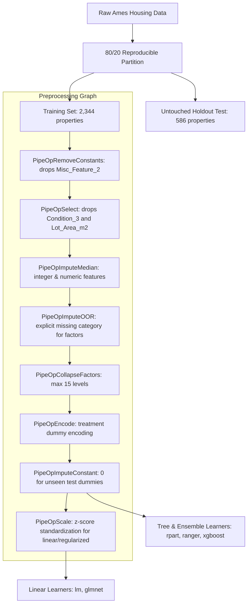

# Explainable House Price Prediction Using R and mlr3

[](https://www.r-project.org/)
[](https://mlr3.mlr-org.com/)
[](LICENSE)

An end-to-end, leakage-free, and explainable machine learning system in R for predicting residential property sales prices from the canonical Ames Housing dataset. Built according to the **Master Product Requirements Document (PRD Version 1.0)**.

---

## 1. Project Overview & Research Foundations

The goal of this project is to implement and demonstrate the full practical workflow of R-based machine learning—spanning data quality auditing, directed acyclic graph (DAG) preprocessing, feature engineering, cross-validated model benchmarking, hyperparameter optimization, dual explainable AI (SHAP & LIME), and an interactive web application.

### Methodological Research Foundations
This implementation is grounded in the foundational papers of the `mlr` ecosystem:
1. **mlr: Machine Learning in R (2016)**  
   *Bernd Bischl, Michel Lang, Lars Kotthoff, Julia Schiffner, Jakob Richter, Erich Studerus, Giuseppe Casalicchio, Zachary M. Jones.*  
   *Journal of Machine Learning Research (JMLR), 17(170):1–5.*  
   *Core Contribution:* Unified, object-oriented framework for classification, regression, and resampling in R.
2. **mlr3: A Modern Object-Oriented Machine Learning Framework in R (2019)**  
   *Michel Lang, Martin Binder, Jakob Richter, Patrick Schratz, Florian Pfisterer, Stefan Coors, Quay Au, Giuseppe Casalicchio, Lars Kotthoff, Bernd Bischl.*  
   *Journal of Open Source Software (JOSS), 4(44):1903. DOI: 10.21105/joss.01903.*  
   *Core Contribution:* Modular, extensible R6 architecture built upon `data.table` for high performance and clean experiment tracking.
3. **mlr3pipelines: Flexible Machine Learning Pipelines in R (2021)**  
   *Martin Binder, Florian Pfisterer, Michel Lang, Lennart Schneider, Lars Kotthoff, Bernd Bischl.*  
   *Journal of Machine Learning Research (JMLR), 22(184):1–7.*  
   *Core Contribution:* Composable `PipeOp` dataflow graphs supporting leakage-safe preprocessing, branching, and joint parameter exposure.
4. **Applied Machine Learning Using mlr3 in R (2024)**  
   *Bernd Bischl, Raphael Sonabend, Lars Kotthoff, Michel Lang (Eds.), CRC Press.*  
   *Chapter 9: Preprocessing* documents the educational adaptation of the Ames Housing dataset and its intentional pedagogical quirks.

---

## 2. Dataset & Educational Data-Quality Audit

The canonical dataset is sourced strictly from `mlr3data::ames_housing`:
- **Observations:** 2,930 residential properties in Ames, Iowa (2006–2010).
- **Target:** `Sale_Price` (USD).
- **Predictors:** 81 predictor attributes (47 categorical factors, 34 numerical features).

### Controlled Handling of Intentional Quirks (PRD Section 4.2)
The adapted `mlr3data` distribution embeds deliberate pedagogical anomalies audited in `R/02_data_audit.R`:
- **Constant Feature (`Misc_Feature_2`):** Contains only 1 distinct factor level (`Othr`); eliminated using `po("removeconstants")`.
- **Duplicate Feature (`Condition_3`):** 100% identical duplicate of `Condition_2`; pruned using `po("select")`.
- **Duplicate Scale Metric (`Lot_Area_m2`):** Perfectly correlated ($r = 1.000$) duplicate of `Lot_Area`; pruned using `po("select")`.
- **Structural Missingness:** Variables such as `Pool_QC`, `Misc_Feature`, `Alley`, `Fence`, and basement amenities have structural NAs indicating absence of feature; imputed using `po("imputeoor")` and `po("imputemedian")`.
- **High Cardinality:** Categorical variables with numerous levels are compressed using `po("collapsefactors", target_level_count = 15)` to prevent out-of-sample factor level misalignment.

---

## 3. End-to-End Pipeline Architecture

To prevent data leakage, all feature transformations are encapsulated inside an `mlr3pipelines` DAG:



---

## 4. Defensible Feature Engineering

Implemented in `R/05_feature_engineering.R` with documented domain rationale:
1. **Total Living Area (`Total_Living_Area`):** `Gr_Liv_Area + pmax(0, Total_Bsmt_SF - Bsmt_Unf_SF)` ($r = 0.7315$).
2. **Total Bathrooms (`Total_Bathrooms`):** `Full_Bath + 0.5 * Half_Bath + Bsmt_Full_Bath + 0.5 * Bsmt_Half_Bath` ($r = 0.6362$).
3. **Total Porch/Deck Space (`Total_Porch_SF`):** Unified sum of wood deck, open porch, enclosed, and screen porches ($r = 0.3835$).
4. **Property Age at Transaction (`Age_At_Sale`):** `max(0, Year_Sold - Year_Built)` ($r = -0.5589$).
5. **Remodel Age (`Years_Since_Remodel`):** `max(0, Year_Sold - Year_Remod_Add)` ($r = -0.5350$).
6. **Quality $\times$ Size Interaction (`Qual_x_LivingArea`):** `Overall_Qual_score * Gr_Liv_Area` ($r = 0.8454$).

---

## 5. Model Benchmarking Results (5-Fold CV)

Six candidate model architectures were benchmarked on identical 5-fold cross-validation splits on the 2,344 training properties:

| Rank | Model Family | Learner ID | Cross-Validation MAE (USD) | RMSE (USD) | $R^2$ Variance Explained |
| :---: | :--- | :--- | :---: | :---: | :---: |
| 🥇 | **Gradient Boosted Trees** | `regr.xgboost` | **$15,321** | **$25,941** | **89.3%** |
| 🥈 | **Random Forest Ensemble** | `regr.ranger` | **$15,858** | **$26,183** | **89.1%** |
| 🥉 | **ElasticNet Regularization** | `regr.glmnet` | **$16,749** | **$39,843** | **71.8%** |
| 4 | **Linear Regression (Baseline)** | `regr.lm` | **$21,093** | **$35,967** | **78.6%** |
| 5 | **Decision Tree** | `regr.rpart` | **$27,458** | **$40,384** | **74.3%** |
| 6 | **Featureless Mean Baseline** | `regr.featureless` | **$58,761** | **$79,962** | **-0.5%** |

### Answers to PRD Experiment Matrix (Section 11.3)
- **E1 (Baseline vs Linear):** Moving from a constant mean predictor ($58,761 MAE) to a transparent linear model ($21,093 MAE) captures 78.6% of outcome variance.
- **E2 (Linear vs Regularized):** ElasticNet penalization handles high-dimensional multicollinearity, improving MAE by over $4,300.
- **E3 (Tree vs Linear):** A single decision tree ($27,458 MAE) underperforms linear regression, showing that depth-limited step functions alone cannot capture smooth price gradients.
- **E4 & E5 (Ensembles & Boosting):** Random Forest and XGBoost achieve top-tier performance (~$15,300–$15,800 MAE), capturing non-linear interactions across size, quality, and location.

---

## 6. Explainable AI Strategy (SHAP & LIME)

The XAI layer (`R/09_explainability.R`) adheres to the non-causal attribution boundaries specified in PRD Section 12.4:
- **Global Permutation Importance:** Identifies `Qual_x_LivingArea`, `Total_Living_Area`, `Gr_Liv_Area`, `Overall_Qual`, and `Age_At_Sale` as the premier global drivers across the dataset.
- **Local SHAP Explanations:** For any individual house, Shapley values quantify the exact positive and negative dollar contributions of each feature relative to the expected dataset baseline ($180,800).
- **Representative Profiles:** Precomputed and visualized across 3 market tiers (Starter < $110k, Median ~$160k, Luxury > $350k).
- **Non-Causal Governance:** Visualizations explicitly state that attributions reflect statistical model behavior within the trained learner, rather than real-world appraisal warranties or causal guarantees.

---

## 7. Interactive Shiny Application

An interactive web application (`app/app.R`) provides a user interface powered by `bslib`:
- **Dual-Tier Input Strategy:** Switch effortlessly between **Practical / Basic Mode** (core intuitive sliders) and **Comprehensive / Advanced Mode** (full property specifications).
- **Transparent Assumption Audit:** Live table enumerating all defaulted background variables (e.g. utilities, foundation, roof style) to eliminate hidden assumptions.
- **Real-Time Valuation:** Instant predicted price, estimated uncertainty interval, and property summary.
- **On-Demand SHAP Attribution:** Visual waterfall breakdown indicating which features drive the home value above or below market average.
- **Integrated Benchmarks & EDA:** Embedded interactive tabs displaying cross-validation error curves, residual diagnostics, and dataset correlation charts.

### Launching the Application
```R
# From the project root in R / RStudio:
shiny::runApp("app")
```

---

## 8. Repository Structure

```
Explainable-House-Price-Prediction-R-mlr3/
├── R/
│   ├── 01_setup.R              # Environment setup, canonical data loading, 80/20 partition
│   ├── 02_data_audit.R         # Data quality audit: constants, duplicates, ranges, target skew
│   ├── 03_eda.R                # Exploratory Data Analysis and publication-quality plots
│   ├── 04_preprocessing.R      # mlr3pipelines DAG: constants, imputation, encoding, scaling
│   ├── 05_feature_engineering.R # Domain features: total living area, baths, age, quality interaction
│   ├── 06_benchmark_models.R   # 5-Fold CV benchmark across 6 model families
│   ├── 07_tuning.R             # Hyperparameter tuning with paradox and mlr3tuning
│   ├── 08_evaluation.R         # Final holdout test evaluation (20%) and residual diagnostics
│   ├── 09_explainability.R     # Dual XAI: Global importance, local SHAP & LIME
│   └── 10_utils.R              # Reusable logging, metric calculation, and ggplot theme
├── app/
│   └── app.R                   # Interactive Shiny application (bslib UI + mlr3 scoring)
├── figures/                    # High-resolution PNG visual artifacts
├── reports/                    # Serialized models, evaluation metrics, and audit reports
├── .gitignore                  # Git ignore rules for R & renv
├── LICENSE                     # MIT License
└── README.md                   # Project documentation & PRD traceability
```

---

## 9. Reproducibility & Execution Guide

### Prerequisites
- R (>= 4.4.0)
- Operating System: Windows, macOS, or Linux

### Step-by-Step Reproduction
Execute the scripts sequentially from the project root:

```powershell
# 1. Environment & Partitions
Rscript R/01_setup.R

# 2. Data Quality Audit
Rscript R/02_data_audit.R

# 3. Exploratory Data Analysis
Rscript R/03_eda.R

# 4. Pipeline Smoke Test
Rscript R/04_preprocessing.R

# 5. Feature Engineering
Rscript R/05_feature_engineering.R

# 6. Model Benchmarking (5-Fold CV)
Rscript R/06_benchmark_models.R

# 7. Hyperparameter Tuning
Rscript R/07_tuning.R

# 8. Final Holdout Evaluation
Rscript R/08_evaluation.R

# 9. Explainability Analysis
Rscript R/09_explainability.R

# 10. Launch Shiny Application
Rscript -e "shiny::runApp('app')"
```
